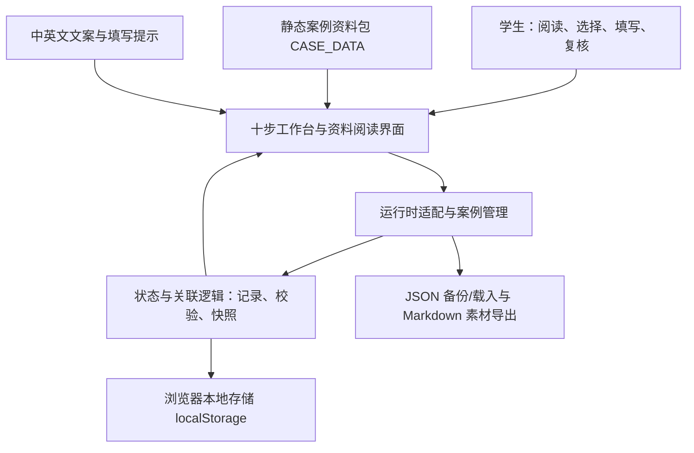

# Fieldnotes：产品定位、功能与架构（PPT 参考）

> 面向负责制作 PPT 和课堂讲解的组员。根据 2026-10-11 当前 `main` 的代码整理；产品代码基线：`ed2bd3b`。本文介绍工具，不提供案例分析结论。

## 1. 产品是什么

**Fieldnotes 是一个按照十步案例分析方法组织思考、查阅依据和记录修订的工程伦理工作台。**

它帮助学生自己提出问题、选择事实、解释关联、比较原则并作出判断。程序负责组织和保存过程，分析内容由小组填写。

可用于 PPT 的一句话：

> 我们把十步方法转化为一个可操作的工作台，让“问题—依据—判断—修订”的过程更清楚，而不是让程序替我们完成分析。

英文表述：

> Fieldnotes is an offline engineering ethics workbook that helps students structure their own case analysis, connect evidence to questions, and review their reasoning.

### 使用对象与问题

| 使用对象 | 遇到的困难 | 产品提供的帮助 |
|---|---|---|
| 初学者 | 不知道每一步该写什么 | 十步导航、空状态指引、可以轮换的填写提示 |
| 小组分析者 | 材料多，难以判断哪些与问题有关 | 搜索、筛选、原文与出处阅读、手写引用理由 |
| 需要复核分析的小组 | 修改前后变化不清楚 | 复核记录、初步/复核后快照、修订对比 |
| 课堂展示者 | 换电脑、联网或启动服务不方便 | 离线单文件 HTML、JSON 载入存档 |

**泛化定位：**工作台不以福岛作为固定标题，可新建其他案例并添加材料。福岛是当前预置示例资料包，不是产品唯一支持的案例。

## 2. 十步如何变成可操作的页面

下面是当前界面的名称与操作，不应把界面中的建议数量或示例问题说成教材强制要求。

| 步骤 | 页面名称 | 用户自己完成的工作 | 程序提供的支持 |
|---|---|---|---|
| 01 | 识别伦理问题 | 提出值得讨论的伦理问题，补充相关行动者 | 添加问题卡片、轮换提问角度 |
| 02 | 聚焦核心问题 | 选出核心问题，说明聚焦理由，必要时改写问题 | 从第 1 步已有问题中选择，保留同一条记录 |
| 03 | 确定相关事实 | 选择相关事实，解释其与问题的关系，记录缺失信息 | 查阅资料库、主动关联问题、显示已选事实和信息缺口 |
| 04 | 作出合理假设 | 在信息不完整时提出暂定假设，说明依据与推断关系 | 添加假设、搜索和选择依据、记录关联理由 |
| 05 | 澄清概念定义 | 区分他人的理解和本组采用的含义 | 候选术语入口、两栏定义表单，定义由用户填写 |
| 06 | 开展伦理分析 | 判断原则适用性、排序、解释原则冲突与取舍 | 原则选择、问题关联、排序、冲突记录表单 |
| 07 | 回顾分析过程 | 检查遗漏、偏见与前后矛盾，决定哪些记录要修改 | 检查清单、逐条复核、跳回原步骤修改 |
| 08 | 形成明确结论 | 回答核心问题，写出论证理由 | 为核心问题建立回答记录，保持问题与回答关联 |
| 09 | 现实约束与责任 | 讨论当时有哪些约束、可行替代和责任影响 | 约束记录、替代选择与责任判断表单 |
| 10 | 避免伦理问题 | 提出预防措施，并考虑谁可以实施 | 添加预防措施卡片、记录相关行动者 |

### “帮助自己分析”具体体现在哪里

- 添加问题和结论时，文本栏从空白开始；程序不代写答案。
- 第 3 步只显示用户主动选用的事实，不把整个资料包直接当成分析结果。
- 引用材料时，需要选择关联的问题，并亲自说明“为什么相关”。
- 添加术语只是建立待填写的定义栏；添加原则也不会生成适用理由。
- 31 条中英文提示提供思考角度和表达示例，点击“填写提示”或“换个角度”可轮换；提示不是具体案例的答案，也不是教材原文引用。
- 复核和快照保留用户判断的变化；最终结论和自我反思仍由小组成员完成。

## 3. 当前已经实现的主要功能

### A. 分步写作与新手引导

十步导航、问题/假设/定义/原则等结构化卡片、空状态操作指引、轮换提示。页面支持返回前序步骤继续修改，并可标记本步已检查。

### B. 资料与依据工作区

资料分为事实、原则与权利、时间线、来源目录、术语提示五类。列表每页 12 条，搜索覆盖整个库，支持事实类别、来源和已引用筛选。

桌面采用列表与阅读区双栏；手机采用列表和详情切换。阅读区展示摘要、出处，以及资料包已有的原文、定位和核验备注。引用理由可以逐问题暂存，主动保存后才加入分析；可以更新或移除引用。

**它在哪些步骤发挥作用：**

| 步骤 | 使用方式 |
|---|---|
| 03 | 选事实、核对出处、说明与问题的关系 |
| 04 | 为假设选择依据，区分已知事实与暂定推断 |
| 05 | 查看术语提示，并自己澄清概念 |
| 06 | 查阅候选原则，自己解释适用性和冲突 |
| 07 | 回查原文、来源、遗漏和反例 |

第 8—10 步也可以返回资料区查阅，但查阅本身不会自动产生结论或预防措施。

### C. 案例与草稿管理

支持新建和切换案例，每个案例独立保存。新建案例从空白事实、时间线和分析开始；可以添加带来源、年份和类别的事实材料，不继承福岛报告的评估结论。当前没有在线多人同时编辑功能，跨电脑交接通过 JSON 文件完成。

### D. 复核、快照与修订对比

工具栏可以保存“初步”和“复核后”两个命名快照，再打开“对比修订”。页面展示新增、修改、删除的记录以及相关关联数量变化，用来说明小组如何调整分析。

适合讲解的重点是：**我们保留了判断如何变化的过程，而不只展示最终结论。**

当前对比覆盖代码中指定的记录字段，并非所有字段的完整审计；它也不会评价哪一版在伦理上更正确。依赖检查和待复核标记属于结构保护，不是伦理正确性评分。

### E. 本地保存与导入导出

- 草稿保存到当前浏览器的 `localStorage`，提供保存状态反馈。
- JSON 用于备份、恢复和跨电脑载入；自建案例的存档包含案例材料和分析。
- Markdown 导出用于整理人工填写的分析素材，不是自动生成的完整报告。
- 导入检查版本、案例标识、结构和引用完整性；发现错误时取消载入，避免覆盖当前草稿。

课堂电脑不会自动获得自己电脑的草稿，需提前准备 JSON 存档，并在正式 HTML 中试载。

### F. 语言与视觉体验

核心工作区支持中英文切换。十步采用统一的卡片、表单和阶段配色；提示区使用较紧凑的排版，手机适配资料阅读和操作按钮。

界面切换语言不代表自动翻译资料原文或用户填写的分析。修订、存档和报告素材导出的系统文案已补齐英文。PPT 可说“支持中英文界面”，不要说“所有内容实时双语翻译”。

## 4. 基本架构：全部在浏览器里运行

**当前没有必须启动的后端服务器，也没有在使用时调用 LLM、智能体或联网检索接口。**小组所称的“后端”主要是随页面运行的 JavaScript 状态、校验和存储逻辑。

PPT 的架构图可以简化为四个框：**资料层 → 界面层 ↔ 逻辑层 → 本地存储/文件导出**。学生的判断贯穿界面操作。

### 代码模块对应关系（供制作架构页参考）

| 模块 | 主要文件 | 负责什么 |
|---|---|---|
| 资料层 | `src/data/fukushima.js` | 预置事实、原则、时间线、来源和方法相关配置 |
| 写作界面 | `src/ui/workbench.js` | 十步填写、导航、对话框、存档入口 |
| 资料阅读 | `src/ui/evidence-library.js` | 全库搜索、分页、筛选、阅读和主动引用 |
| 提示与语言 | `src/ui/guidance.js`、`src/ui/i18n.js` | 31 条轮换提示及界面文案 |
| 修订比较 | `src/ui/revision-compare.js` | 比较初步与复核后的快照 |
| 案例管理与适配 | `src/ui/case-workspaces.js`、`src/ui/applogic-runtime.js` | 案例隔离、导入校验、界面与正式状态层衔接 |
| 状态逻辑 | `src/logic/` | 记录 ID、状态、依赖保护、检查与持久化 |
| 视觉样式 | `src/styles/workbench.css` | 配色、字体、布局、手机适配 |
| 单文件构建 | `tools/build.py` | 将 CSS、资料和脚本内联到 `dist/index.html` |

开发源文件分模块维护，**课堂交付文件是 `dist/index.html`**，可以离线双击运行。`preview.html` 是另一个单文件预览构建，不应把它与正式逻辑接入状态完全等同。

技术边界：正式交付页的预置案例使用 AppLogic 适配器；正式 store 目前仍固定内置案例 ID，因此自建案例继续使用兼容运行时，保持独立保存和导入导出。后续可统一为支持任意案例 ID 的正式运行时。

教学边界：当前界面有全部十步的操作入口，但不等于已经逐项通过报告模板与教材合规审计。同学新加入了 `docs/audit/requirements.md` 和 `docs/audit/audit-plan.md`；其中的问题数量、核心问题数量和报告细分字段应另行核对。PPT 应介绍现有功能，不宣称“完全满足所有教材与报告模板要求”。

## 5. 当前资料库与功能边界

预置福岛资料包版本为 2.1，包含 **50 条事实、33 条候选原则、15 条时间线、6 个来源条目、4 个术语提示**。数据文件还保存 9 条报告评估，但这些评估未作为资料区的事实或自动结论展示。

这里的“知识库”是随 HTML 打包的结构化资料。来源、原文和备注帮助用户回查依据；“待复核”和置信度是资料包的标记，不代表程序自动核实了材料。

### PPT 可以强调

- 十步方法从阅读流程变成具体操作。
- 每条引用要求解释与问题的关系，避免只堆砌材料。
- 提示帮助初学者打开思路，判断权始终留给学生。
- 快照对比使修订过程可见。
- 单文件离线运行，适合课堂展示；界面支持多个案例。

### 不应描述成已实现

- AI 自动分析、生成结论、自动给出伦理评分。
- RAG、联网数据库、实时检索或自动核验来源。
- 云端账号、多人实时协作、自动同步不同电脑的草稿。
- 所有原则都等于教材附录 I 的完整内容；33 是当前资料包数量。
- 已自动完成课程报告、案例发现或自我反思。

后续方向可以是：统一多案例正式运行时、完善双语辅助文案、增加资料编辑与导入能力、扩大修订对比字段范围。这些应标注为未来改进。

## 6. PPT 与现场演示建议

按老师最新要求控制在 **12—13 分钟以内**，程序架构介绍占 2—3 分钟；分析展示重点放在前五步，程序本身覆盖全部十步。

| 内容 | 建议时间 | 页面或 PPT 素材 |
|---|---|---|
| 产品定位与架构 | 2—3 分钟 | 一句话定位、四层架构图、程序简短操作 |
| 所选案例与核心问题 | 约 2 分钟 | 案例背景，第 1—2 步的小组记录 |
| 事实、缺口与假设 | 约 3 分钟 | 第 3—4 步的依据、原文定位和推断边界 |
| 概念澄清与前五步结果 | 约 2 分钟 | 第 5 步两栏定义，小组自己的阶段性发现 |
| 设计迭代/自我反思（时间允许） | 约 1 分钟 | 真实 AI 对话与设计修改证据 |
| 切换与时间缓冲 | 约 1 分钟 | 提前载入页面与 PPT/PDF |

### 2—3 分钟程序演示路线

1. 第 1 步：展示空白填写区和“换个角度”，说明程序只给思考方向。
2. 第 3 步：搜索一条材料，读原文和出处，选择关联问题并解释引用理由。
3. 快速指出十步导航和后续分析页面，说明程序覆盖整个流程。
4. 若已有真实修订记录，展示“初步/复核后”对比；否则不要临时制造修订证据，直接转 PPT 展示前五步发现。

现场不要逐个点开全部功能。优先展示“人工输入 → 核对依据 → 解释关联”这条完整路径。

### 建议截图

- 第 1 步：问题卡片与轮换提示。
- 资料区：列表、原文/出处和引用理由。
- 第 4 步：假设及依据。
- 第 5 步：他人理解与本组定义。
- 如有真实分析记录：初步/复核后修订对比。

提示卡最新版视觉示例见 `docs/ai-logs/frontend-qa-hint-layout-v3/`。其他截图应以当前 `dist/index.html` 和小组自己的分析为准；仓库 QA 图中的虚构内容不能当成案例发现。

## 7. 自我反思与交付提醒

可以结合真实聊天记录讨论：AI 如何影响了最初的功能选择、为什么资料页从长列表改为搜索/分页阅读区、提示卡如何经过多轮字号和布局调整。这里提供的是反思素材方向，最终反思应由成员自己写。

老师要求的是 **vibe-coding 的真实 AI 对话截图**。仓库里的页面 QA 图只能展示产品迭代，不能替代聊天截图；不要把迭代次数或未核对内容编造为事实。

展示前准备：

- 在课堂类似环境下离线打开 `dist/index.html`，载入小组 JSON 存档并检查前五步。
- 在浏览器中保留 HTML，在 PPT/PDF 中组织小组自己的发现，避免临场长时间填写。
- 提前确定至少一位讲解者；展示前 15 分钟完成老师要求的文件提交。
- HTML 按老师指定的 `Group #… 4960` 格式命名；按要求提交 PPT 的 PDF 版本和真实 AI 对话截图。

本文用于 PPT 策划和产品介绍，不能替代教材核对、事实核验与小组自己的案例分析。
